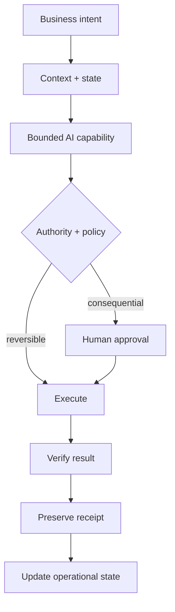

# Lalo Pacheco Sánchez — AI Systems & Solutions Architecture

**Governed AI implementation · workflow orchestration · systems integration · human-approved execution**

I design operating systems for AI-enabled work: the architecture connecting people, software, data, models, permissions, workflows, and evidence so that AI can be useful without becoming unaccountable.

This repository is a recruiter- and collaborator-facing portfolio. It presents sanitized architecture and case studies from a larger private implementation body while preserving the proprietary machinery behind it.

## 60-second portfolio tour

1. **Run the technical proof:** [Governed AI Control Plane](https://github.com/lpssovereign/lps_control_plane)  
   Python implementation of policy-gated execution, approval states, audit records, replay, delegation, tests, and CI.

2. **See legal-tech reasoning:** [PhiNeX](case-studies/phinex.md)  
   Governed evidence-to-resolution architecture for sensitive records, claims, provenance, review, and consequential actions.

3. **See customer implementation thinking:** [Legal AI Implementation Walkthrough](docs/LEGAL_AI_IMPLEMENTATION_WALKTHROUGH.md)  
   A vendor-neutral blueprint for moving a law office from workflow discovery through configuration, validation, adoption, and measurable operations.

4. **See guided learning and edtech relevance:** [Vizion](case-studies/vizion.md)  
   Source-backed, stateful procedural guidance with uncertainty, safety gates, verification, accessibility, and recovery.

## Professional focus

I am best aligned with roles involving:

- AI solutions engineering and customer implementation
- legal-tech, edtech, and other high-accountability domains
- workflow discovery, requirements translation, and systems mapping
- APIs, OAuth, webhooks, data movement, and integration design
- human-in-the-loop authority, governance, provenance, and auditability
- technical demonstrations, implementation plans, enablement, and adoption
- operational UX: making complex systems understandable and usable

The recurring question across the work is:

> How do we turn fragmented AI capabilities into reliable organizational capability without making the human become the integration layer?

## Evidence map

| Evidence | What it demonstrates | Maturity |
|---|---|---|
| [Governed AI Control Plane](https://github.com/lpssovereign/lps_control_plane) | Python, state machines, policy enforcement, audit trails, tests, CI | **Tested reference implementation** |
| [PhiNeX](case-studies/phinex.md) | Legal evidence architecture, data boundaries, human approval, provenance | **Private implementation; sanitized public architecture** |
| [Marathon](case-studies/marathon.md) | Work reconciliation across tasks, documents, agents, approvals, and partial execution | **Private implementation; sanitized public architecture** |
| [Kairos](case-studies/kairos.md) | Relationship-aware communication, timing, context, and next actions | **Private implementation; sanitized public architecture** |
| [Vizion](case-studies/vizion.md) | Source-backed procedures, accessible guidance, verification, and recovery | **Specified; incremental implementation** |
| [SOPHIA](case-studies/sophia.md) | Delegation, jurisdiction, revocation, appeal, and agent accountability | **Architecture and governance model** |
| [SynaptiQ](case-studies/synaptiq.md) | Bounded domain intelligence and human-pattern systems | **Architecture and partial implementation** |

Maturity labels describe the underlying work; they are not claims of client deployment, external certification, or production security review.

## Core architecture pattern

## Design principles

### Capability is not authority
A model or agent being able to perform an action does not mean it is authorized to perform it.

### Intelligence should be bounded
Domains retain distinct responsibilities, data boundaries, and execution semantics instead of collapsing into one omnipotent agent.

### Humans should not be APIs
Systems should carry state and coordinate services directly. Human attention should be reserved for judgment, authorization, relationships, and consequential decisions.

### Consequential actions need receipts
Important execution should be source-linked, permission-aware, observable, verifiable, and reconstructable.

### Complexity needs an understandable surface
A sophisticated system should still give operators a clear view of what happened, what needs attention, and what remains blocked.

## From discovery to adoption

My solutions-engineering approach follows a practical sequence:

- **Discover:** goals, users, constraints, risks, and current tools
- **Map:** workflows, data, permissions, decisions, and failure paths
- **Configure:** integrations, roles, policies, prompts, and handoffs
- **Validate:** test cases, edge cases, human approvals, and acceptance criteria
- **Adopt:** training, documentation, rollout, and change support
- **Observe:** usage, exceptions, quality, business outcomes, and iteration

See the [Legal AI Implementation Walkthrough](docs/LEGAL_AI_IMPLEMENTATION_WALKTHROUGH.md) for a concrete example.

## Public/private boundary

This portfolio publishes architecture, sanitized flows, design rationale, selected non-proprietary patterns, and bounded case studies. It does not publish credentials, private/customer data, production infrastructure, proprietary orchestration logic, reusable internal workflow libraries, private instructions, or deployment secrets.

See [Public Portfolio Boundary](docs/PUBLIC_PORTFOLIO_BOUNDARY.md).

## About

**Lalo Pacheco Sánchez**  
Denver, Colorado · Open to remote AI solutions, implementation, enablement, and systems roles

My background combines technical system-building with client-facing financial services, operations, education, and community leadership. That combination shapes how I work: understand the actual human process, translate it into an implementable system, establish authority and evidence boundaries, and help people adopt what was built.

**GitHub:** [github.com/lpssovereign](https://github.com/lpssovereign)
