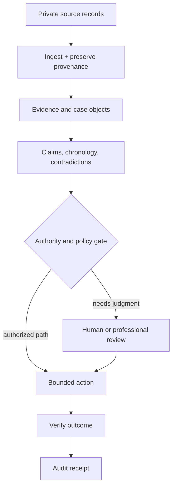

# PhiNeX — Governed Evidence-to-Resolution Infrastructure

**Maturity:** implemented in a private repository; this page presents a sanitized architecture.  
**Claim boundary:** portfolio work, not a client deployment, law practice, or autonomous legal service.

## Problem

High-stakes matters rarely arrive as clean data. They arrive as fragmented records: documents, emails, messages, allegations, dates, participants, institutional rules, procedural options, and actions that may carry legal or financial consequences.

A useful system must do more than retrieve or summarize. It must preserve provenance, distinguish assertion from evidence, expose contradictions, control who may act, and retain a receipt of consequential decisions.

## Architecture

PhiNeX converts source material into governed case objects and routes it through bounded processes:

The underlying work includes separated data stores, evidence/case/corpus/legal/counsel/audit schemas, governance gates, deterministic pseudonymization and redaction signals, source-linked research ingestion, approved-record retrieval, and architecture/governance tests.

## Key design decisions

| Concern | Design response |
|---|---|
| Sensitive source material | Separate stores and access boundaries |
| Unsupported conclusions | Source links and claim/evidence separation |
| Conflicting records | Explicit contradiction and chronology objects |
| Consequential actions | Scoped approval before external execution |
| Privacy in analysis | De-identification and redaction signals |
| Accountability | Append-only action and decision receipts |
| Professional judgment | Escalation to human or qualified professional review |

## What this demonstrates

- translating an ambiguous, high-stakes workflow into a data and operating model
- designing for provenance, privacy, auditability, and human authority
- separating research, evidence processing, recommendations, and execution
- defining failure paths and escalation rather than assuming model certainty
- communicating technical architecture to non-engineering stakeholders

## Solutions-engineering relevance

In a legal-AI implementation role, the same reasoning becomes customer work:

1. discover the firm's matter lifecycle and pain points;
2. map document sources, users, permissions, review steps, and systems of record;
3. configure bounded workflows and integrations;
4. validate output against representative matters and acceptance criteria;
5. train attorneys and staff on use, review, escalation, and limitations;
6. monitor adoption, exceptions, time savings, and quality indicators.

See the [Legal AI Implementation Walkthrough](../docs/LEGAL_AI_IMPLEMENTATION_WALKTHROUGH.md) for the full vendor-neutral rollout blueprint.

## Design principle

PhiNeX is not positioned as an autonomous lawyer. It is an accountable operating layer between human experience, evidence, authority, and the people or institutions authorized to act.
