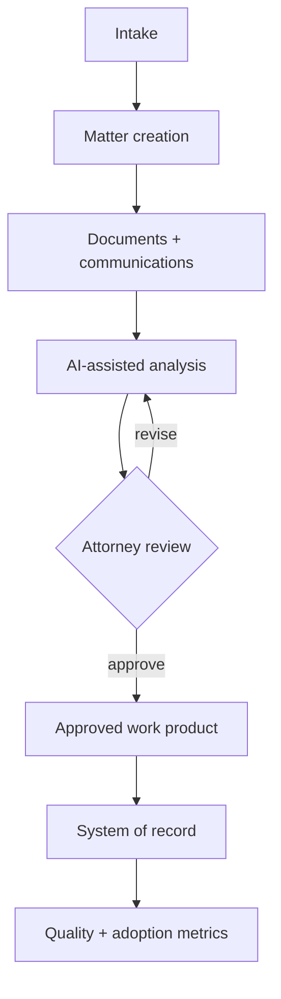

# Legal AI Implementation Walkthrough

**Type:** vendor-neutral solutions-engineering blueprint  
**Status:** portfolio demonstration, not a claim of client deployment

This walkthrough shows how I would help a law office implement an AI workspace within its existing operations. The product may change; the implementation discipline should remain consistent.

## Scenario

A mid-sized law office wants AI assistance for matter intake, document review, chronology building, drafting support, and institutional knowledge retrieval. Attorneys are interested, but the firm's records are fragmented and staff members use different informal processes.

The goal is not to "install AI." The goal is to improve specific workflows while preserving confidentiality, professional judgment, traceability, and adoption.

## 1. Discovery

### Stakeholders

- managing partner or executive sponsor
- practice-area leads
- attorneys, paralegals, and intake staff
- operations and knowledge-management owners
- IT, security, privacy, and compliance stakeholders

### Questions

- Which matter types and steps consume the most time?
- Where do delays, duplicate work, and handoff failures occur?
- Which systems are authoritative for clients, matters, documents, email, and time?
- What may the AI read, recommend, draft, or trigger?
- Which actions always require attorney approval?
- What would success look like after 30, 60, and 90 days?

### Deliverable

A current-state workflow map, prioritized use-case list, risk register, system inventory, and decision-owner matrix.

## 2. Workflow and data mapping

For each use case, define:

| Field | Example |
|---|---|
| Trigger | New matter, new document, or attorney request |
| Inputs | DMS documents, email, intake form, matter metadata |
| System of record | Practice-management or document-management platform |
| AI task | Classify, extract, summarize, compare, or draft |
| Required sources | Matter documents and approved knowledge collections |
| Human gate | Attorney approval before external use |
| Output | Draft, chronology, issue list, or research memo |
| Receipt | Sources, reviewer, decision, timestamp, and destination |
| Failure path | Hold, explain uncertainty, and route for manual handling |

## 3. Solution design

### Integration layer

- authenticate using supported identity and access controls;
- connect approved document, email, and matter systems;
- preserve source identifiers and matter boundaries;
- use least-privilege scopes and separate development/test configurations;
- define retry, timeout, duplicate, and partial-failure behavior.

### Governance layer

- assign capabilities by role and matter;
- distinguish read, recommend, draft, approve, and execute permissions;
- prohibit external or corpus-changing actions without the defined authority;
- retain source, decision, reviewer, and execution receipts;
- document retention, escalation, and incident-handling requirements.

### Experience layer

- place AI in the workflow where work already happens;
- show sources and uncertainty close to the output;
- make approval and correction paths obvious;
- avoid forcing staff to reconstruct context across disconnected tools.

## 4. Configuration and prototype

Start with one narrow workflow and representative, authorized test data.

Example pilot: produce a source-linked chronology from a defined matter folder.

Acceptance criteria might include:

- every material event links to its source;
- uncertain dates are labeled rather than invented;
- contradictory records are surfaced;
- matter boundaries are maintained;
- the output remains a draft until attorney review;
- approved results return to the correct system of record;
- failures are visible and recoverable.

## 5. Validation

Use a test matrix covering:

- ordinary matters and document formats
- missing, duplicate, conflicting, and corrupted inputs
- permission and matter-boundary violations
- prompt-injection or malicious document content
- unsupported conclusions and absent sources
- interrupted integrations and partial completion
- correction, rollback, and audit reconstruction

Validation is both technical and operational: the workflow must function correctly and fit the way the team actually works.

## 6. Enablement and rollout

- identify pilot champions and decision owners;
- train with matter-specific scenarios rather than generic feature tours;
- teach verification, correction, escalation, and limitations;
- publish short role-based runbooks;
- hold office hours during the pilot;
- capture recurring friction as configuration or product feedback.

## 7. Measurement

Track measures tied to the original workflow:

| Category | Example indicators |
|---|---|
| Adoption | active users, workflow completion, repeat use |
| Efficiency | cycle time, manual touches, search or drafting time |
| Quality | correction rate, source-link completeness, escalations |
| Reliability | integration errors, retries, partial failures |
| Governance | approval compliance, access exceptions, receipt completeness |
| Value | matters supported, staff capacity returned, user confidence |

No single metric proves success. The useful question is whether the system improves the workflow without weakening professional control.

## 8. Handoff and iteration

The implementation closes with:

- configured workflow and integration inventory
- acceptance-test evidence
- role and authority matrix
- administrator and user runbooks
- known limitations and escalation procedures
- baseline metrics and review cadence
- prioritized backlog for the next use case

## Why this belongs in the portfolio

This blueprint demonstrates the work between a product demo and a durable customer outcome: discovery, workflow translation, technical configuration, governance, testing, enablement, measurement, and iteration.
